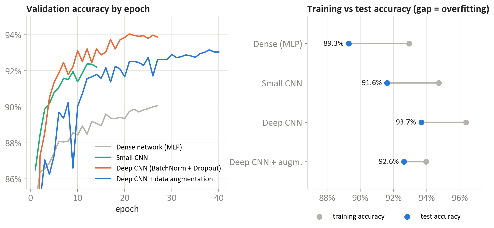
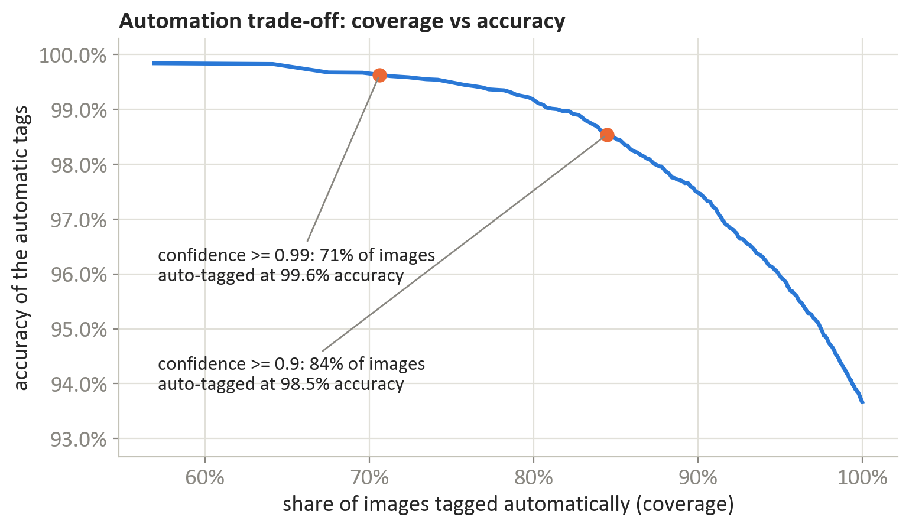
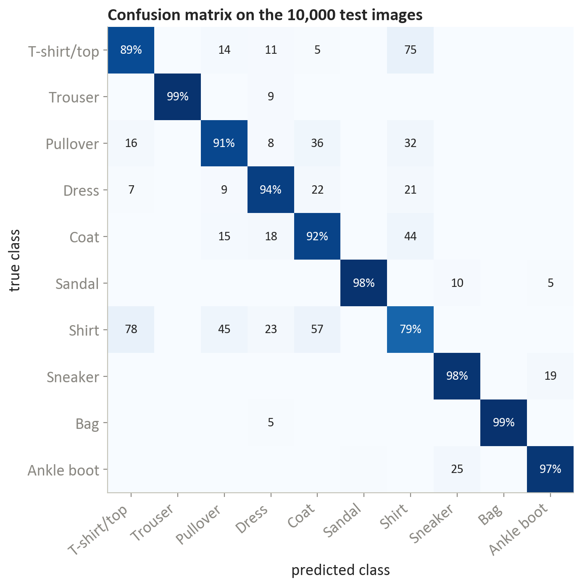
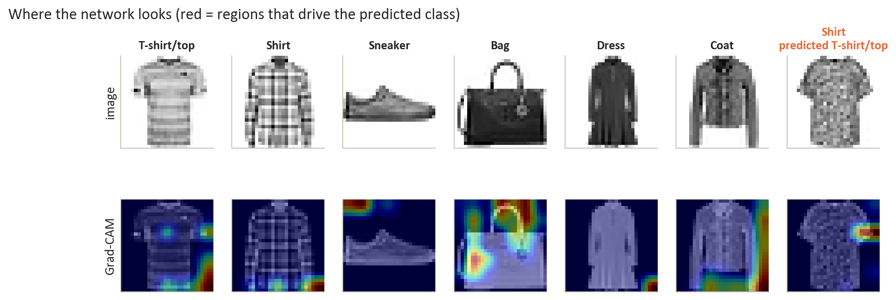

# Fashion product image tagging: from an MLP to a CNN you can trust 80% of the time

A deep-learning project on Fashion-MNIST framed as a business task: auto-tag product photos into ten categories and send the uncertain ones to a person. Four architectures are trained and compared under the same split and budget; the recommended model is a deep CNN with batch normalisation and dropout (93.7% test accuracy). With a confidence gate at 0.95 it tags 80% of images automatically at 99.1% accuracy and routes the other 20% to review. Grad-CAM and feature-map visualisations show what the network looks at and where its confident mistakes come from.

Final project for *Deep Learning and Reinforcement Learning* (IBM Machine Learning Professional Certificate, October 2026).

| | |
|---|---|
| Notebook | [`Deep Learning - Fashion Product Image Classification.ipynb`](Deep%20Learning%20-%20Fashion%20Product%20Image%20Classification.ipynb) |
| Report (10 pages) | [`report/Deep Learning - Final Project Report.pdf`](report/Deep%20Learning%20-%20Final%20Project%20Report.pdf) |
| Data | Fashion-MNIST via `tf.keras.datasets` (54,000 train / 6,000 validation / 10,000 test; no duplicates, no test images in train) |
| Outputs | `figures/` (7 charts), `results/` (every table in the report as CSV) |

## Results

| Model | Parameters | Epochs to best | Train time (CPU) | Test accuracy | Macro F1 | Inference, ms/image |
|---|---|---|---|---|---|---|
| Dense network (MLP) | 235k | 22 | 1 min | 89.3% | 0.893 | 0.03 |
| Small CNN | 422k | 9 | 2 min | 91.6% | 0.916 | 0.06 |
| **Deep CNN, BatchNorm + Dropout** | **289k** | **22** | **24 min** | **93.7%** | **0.937** | **0.22** |
| Deep CNN + data augmentation | 289k | 38 | 33 min | 92.6% | 0.926 | 0.21 |

Same split, same optimiser, early stopping on validation loss, 40-epoch cap. The augmented model was still improving when the cap hit, so it is the one to continue if more training time is available; at the cap it is 1.1 points behind.



### The confidence gate

Instead of trusting every prediction, keep only those whose top-class probability clears a threshold and send the rest to a reviewer:

| Threshold | Auto-tagged | Accuracy on those | Sent to review |
|---|---|---|---|
| none | 100% | 93.7% | 0% |
| 0.90 | 84.5% | 98.5% | 15.5% |
| **0.95** | **80.1%** | **99.1%** | **19.9%** |
| 0.99 | 70.6% | 99.6% | 29.4% |



### Where it fails

Shirts are the hard class (recall 79%): the top confusions are shirt ↔ T-shirt (78 and 75 of 1,000) and shirt → coat (57). Trousers, bags and sandals are above 98.5%. A fifth of the mistakes are made at 0.95+ confidence; the report shows them, and most are items a person would also hesitate over.



### What the network looks at

First-layer kernels and feature maps, then Grad-CAM on correct and wrong predictions: the recommended model attends to collars, sleeves and the silhouette rather than the background.



## Method notes

- Pixel values scaled to 0–1; the 6,000-image validation split is stratified and fixed across models.
- The deep CNN is three convolutional blocks (conv–BatchNorm–ReLU, max-pool, dropout) and a dense head; augmentation adds small shifts, flips and zooms.
- Accuracy confidence intervals and per-class precision/recall are in `results/`.
- Limitations: trained on CPU (TensorFlow on Windows has no GPU support), so the 40-epoch cap was a time budget; model weights were not saved, so reproducing the figures means retraining (about an hour).

## Reproduce

```bash
pip install -r requirements.txt
jupyter notebook "Deep Learning - Fashion Product Image Classification.ipynb"
```

The notebook downloads Fashion-MNIST through Keras, writes `figures/` and `results/`; `report/source/build_report.py` builds the Word report from those CSVs and `export_pdf.ps1` exports it to PDF.
